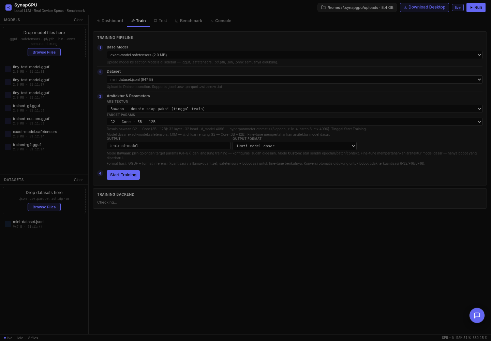
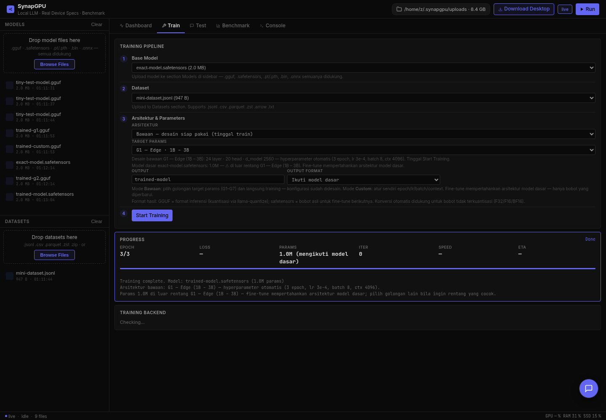
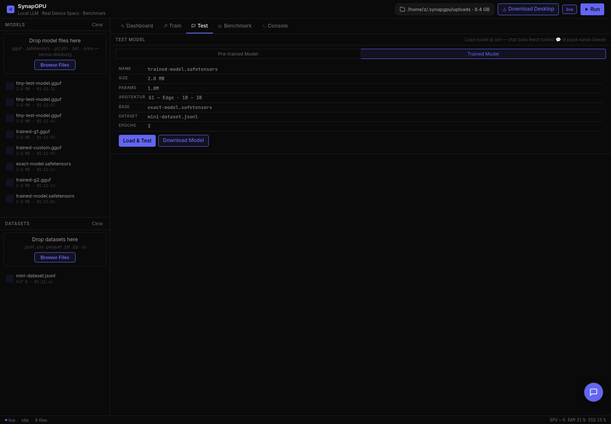

# SynapGPU

**Workbench LLM lokal untuk Windows — drag & drop model dan dataset, training, chat dengan model, benchmark, dan monitor perangkat, semuanya dalam satu aplikasi desktop.**

  

## ⬇️ Download & Instalasi (Windows 64-bit)

Cukup satu langkah — tanpa Git, tanpa Python, tanpa melihat kode:

1. Buka halaman **[Releases terbaru](https://github.com/ARIKO13/SynapGPU/releases/latest)**
2. Download **`SynapGPU-Setup-<versi>.exe`**
3. Dobel-klik → ikuti wizard (**Next → Install → Finish**) → SynapGPU langsung bisa dijalankan

Suka versi portable? Download juga **`SynapGPU-windows.zip`** di release yang sama, ekstrak, lalu dobel-klik **SynapGPU.exe** — tanpa instalasi.

> **Chrome menampilkan "Dangerous download blocked"?** Itu proteksi Safe Browsing untuk file .exe yang belum punya reputasi unduhan — bukan tanda file berbahaya. Klik **Keep** di `chrome://downloads`, atau cocokkan hash **SHA256** yang tertera di catatan release (file `SHA256SUMS.txt`) sebelum menjalankan.

## ✨ Fitur

- **Drag & drop** — model (`.gguf`, `.safetensors`, `.pt/.pth`, `.bin`, `.onnx`) dan dataset (`.jsonl`, `.csv`, `.parquet`, `.zst`, `.txt`) langsung dari file manager.
- **Training pipeline** — pilih **arsitektur bawaan** berdasarkan target params (golongan **G1–Edge 1–3B** s/d **G7–Apex 1.5–5T**, konfigurasi otomatis) atau mode **custom** (atur sendiri epoch, learning rate, batch, context). Pilih format hasil: **GGUF** untuk inference (llama.cpp/Ollama) atau **safetensors** untuk fine-tune lanjutan.
- **Chat dengan model** — jalankan model untuk percakapan; inference lokal via llama.cpp / Ollama / LM Studio, dan test model hasil training langsung dari tab Test.
- **Monitor perangkat real-time** — penggunaan GPU, RAM, dan SSD, plus benchmark perangkat khusus GPU.
- **100% berjalan lokal** di komputermu — model dan dataset tidak diunggah ke mana pun.

  

## 🖥️ Kebutuhan Sistem

| Komponen | Kebutuhan |
| --- | --- |
| OS | Windows 10 / 11 (64-bit) |
| Runtime | WebView2 Runtime (sudah tertanam di Windows 10/11) |
| RAM | ≥ 8 GB |
| GPU | Opsional — untuk benchmark dan inference cepat |

## 🌐 Demo Web

Versi demo berbasis browser (WebGPU) tersedia di **[ariko13.github.io/SynapGPU](https://ariko13.github.io/SynapGPU/)**.

## ❓ Catatan

- Jendela aplikasi muncul 3–8 detik setelah dibuka — normal (loading runtime).
- File log: `%LOCALAPPDATA%\SynapGPU\synapgpu.log`.
- Uninstall lewat **Settings → Apps** atau shortcut *Uninstall* di Start Menu.

  

